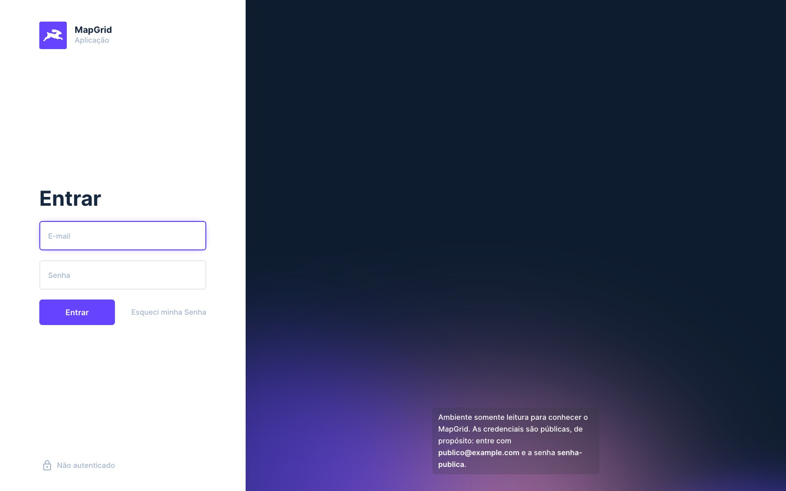

# Directus - MapGrid Layout Extension

[](https://github.com/devix-tecnologia/directus-extension-mapgrid/actions)
[](https://www.npmjs.com/package/@devix-tecnologia/directus-extension-mapgrid)
[](https://github.com/devix-tecnologia/directus-extension-mapgrid/blob/main/License.txt)

A Layout-type extension for Directus that displays a collection in map and grid form at the same time. Built by [Devix Tecnologia](https://devix.co).


**🇺🇸 English** · [🇧🇷 Português](#-português)

---

## 🇺🇸 English

### Features

- **Map and grid together**: the Directus map layout and the Directus table layout side by side,
  over the same query and the same selection
- **Click a row, the map goes there**: the map flies to the item, keeping the current zoom — or
  zooming in, with *Zoom on focus*
- **Click a marker, the row is marked**: instead of leaving the layout for the item page. The mark
  is not the selection, so it does not arm the bulk actions
- **Walk the records**: first, previous, next and last, in the query's order. When the record is on
  another page, the page turns first
- **Play them back**: the camera walks the records on its own, at a configurable interval. With a
  vehicle tracking collection sorted by date, it drives the route in the order it happened
- **Camera tracking**: *free* leaves the map where you left it, *follow* moves only when the record
  leaves the visible area, *keep centred* keeps it in the middle at every step
- **What the Directus layouts already do**: basemap, clustering and display template from the map
  layout; columns, sorting, pagination and spacing from the table layout
- **Where it is heading**: an arrow on the current record, from a course field of the data
  (degrees from north, signed values included) or from the record visited before
- **The trail**: the records already visited, joined in order with arrows repeated along the line,
  the older legs fading. It joins what was visited, not the road between: a jump to a distant row
  draws a straight leg
- **The data's clock**: playback can wait the real time between the records, sped up (1× to 600×),
  instead of a fixed beat. The movement is still from record to record, not continuous
- **Timeline**: the trip on a time axis between the map and the grid, with a tick per loaded
  record. Dragging it jumps to that moment — on any page when the query is sorted by that date
- **Capture card**: the focused record over the map, with its photo — which enlarges on click — its
  fields and its coordinates
- **Measuring**: click the map to mark points and read the distance of the last leg and the total;
  a click near a record snaps to it
- **Reset view**: re-fit the map to the current result set at any time
- **Bulk actions**: select rows and edit or delete them all at once from the header
- **Guided tour**: a balloon per feature — map, grid, filters, navigation, playback, tracking,
  direction, card, timeline, measuring and reset — from the **?** of the toolbar, or by itself on
  the first visit of each browser
- **Room for the map**: on Directus 10, the right sidebar starts collapsed the first time a browser
  opens the collection; opened again, it stays as you left it. Directus 11 keeps its own choice
- **Map and grid, resizable**: drag the handle between them to share the height (or use ↑ ↓ on
  it); the share is kept in your preset, and a double click puts the default back
- **Dates to the second**: the card and the timeline write moments as `27/03/2026 10:30:47`
- **Bilingual interface**: follows the Directus app locale (en-US, pt-BR)

### Installation

Tested with Directus 11.17 and 10.13.

```bash
npm install @devix-tecnologia/directus-extension-mapgrid
```

### Configuration

1. Make sure your collection has a field of type **Map** (geolocation).
2. In the layout dropdown on the right, select **MapGrid**.
3. The layout options have these sections:
   - **Map**: the Directus map layout's own options — basemap, geospatial field, display template
     and clustering
   - **Grid**: the Directus table layout's own options
   - **Zoom on focus**: zoom in on the focused record instead of keeping the current zoom. It says
     nothing about *whether* the camera moves — that is the camera tracking's call
   - **Playback**: how many seconds to wait between records while playing back. One second is the
     floor, because each step asks the map for a camera animation. The pace can instead follow
     **the data clock**, at a chosen speed, reading a date/time field — the first date of the
     sort is used when none is chosen, and only shown, never stored
   - **Direction**: where the current record's arrow points — nowhere, a numeric course field, or
     the bearing from the record visited before
   - **Trail**: how many visited records the trail joins; `0` turns it off
   - **Capture card**: show the focused record in a card, with a photo field and the fields to list
     (the grid's columns when none are chosen)
   - **Tour**: open the guided tour by itself on the first visit of each browser

The geospatial field is detected from the collection, so the layout works before anything is set.

#### Walking the records

The controls sit on the map, in the MapGrid's own toolbar:

| Control | What it does |
| --- | --- |
| ⏮ First / ⏭ Last | The ends of the **query**, not of the page: they turn the page when they have to |
| ◀ Previous / ▶ Next | One record. At the edge of a page, the page turns and the record is the one at the other end of it |
| ▶ Play / ⏹ Stop | Walks forward on its own, and stops by itself at the last record |
| GPS | Cycles the camera tracking: free → follow → keep centred |
| 📏 Measure | Turns the ruler on: clicks on the map mark points, and **Esc** turns it off |
| ⛶ Reset | Fits the map to the whole query again |
| ? Tour | Opens the guided tour; **←** and **→** walk it, **Esc** closes it |

The same steps answer to the keyboard while the layout has the focus: **Home** and **End** for the
ends of the query, **←** and **→** for one record, and **Space** for play/stop. Every Directus
shortcut carries the meta key — `meta+s`, and the `meta+a` of the table below — so holding any
modifier hands the key back to them, and so does typing in a field. Each toolbar control shows its
key in the tooltip.

The order that defines "next" is the query's `sort`, which is the one showing in the grid header.
Sorting by a date/time field is what makes playback drive a route in the order it happened; with
any other sort, it walks that order instead. While a page is being fetched the controls wait, so no
record is skipped.

The current record is marked on its grid row and scrolled into view. It is deliberately **not** the
selection: that one also arms the bulk actions, and "I am looking at this" should not read as "I
marked this to be deleted". On the map it gets a ring of its own, drawn over the canvas: with
**Cluster data** on, the record's point would otherwise be inside a cluster and the playback would
be invisible. The ring is placed by projecting the geometry with the camera the map publishes,
which it only does when a movement ends — so it appears once the camera lands.

The basemaps offered are the ones in **Project Settings → Map**, as in every map of the app. The
chosen basemap is the app's choice, not the MapGrid's: it is shared with the other map layouts and
is not stored in the MapGrid preset — which is why a screen may look different from the one above.

#### Columns

Columns are chosen in the grid's own header, the way the Directus tabular layout does it — not in
the sidebar. The **+** at the end of the header row opens the collection's field list, and dragging
a header moves the column. Clicking a header opens that column's menu, which sorts it ascending or
descending and hides the field — in the Directus tabular layout sorting lives in that menu rather
than in the click itself. Every one of those choices is stored in the preset, so it is still there
on the next visit.

There is no limit on how many columns the grid can show.

#### Upgrading from 1.x to 2.0

2.0 composes the Directus map and table layouts instead of drawing its own, and three of the four
options a 1.x preset stored are no longer read. Nothing is lost from the data; after upgrading, set
these again once per collection:

| 1.x option | In 2.0 |
| --- | --- |
| `coluna1` … `coluna5` | The grid shows the Directus default columns until they are chosen again in its header (the **+**) |
| `geolocation` | Detected from the collection; to pick another field, use **Map → Geospatial field** in the options |
| `title` (popup template) | **Map → Display template** in the options |
| `zoomOnClick` | Still read, as **Zoom on focus** |

### Running Directus with Docker Compose

Download this project, or copy its `docker-compose.yaml`, and start a clean install. With [Docker installed](https://docs.docker.com/get-docker/), run:

```bash
docker compose up
```

### Read-only demo

A stack to publish, where visitors try the MapGrid without changing anything. It brings the
licence plate readings of the tests — fixed cameras, patrol cars and buses across Grande Vitória,
with a photo each — in Portuguese, with every feature on and the tour opening on the first visit.



```bash
pnpm build
DEMO_ADMIN_PASSWORD='a strong one' pnpm demo
```

It comes up on <http://localhost:8070>; visitors sign in as `publico@example.com` /
`senha-publica` — public on purpose, so nobody takes them for a leak — which the login page shows. The seed ends by checking, as the visitor, that reading
works and writing is refused, and that anonymous requests are refused — a demo that turned writable
fails there.

| Variable | Default | |
| --- | --- | --- |
| `DEMO_ADMIN_PASSWORD` | — | Required: the demo never starts with a known admin password |
| `DEMO_ADMIN_EMAIL` | `admin@example.com` | |
| `DEMO_PORT` / `DEMO_PUBLIC_URL` | `8070` / `http://localhost:8070` | Set the URL to the published address |
| `DEMO_USER_EMAIL` / `DEMO_USER_PASSWORD` | `publico@example.com` / `senha-publica` | The visitor |
| `DEMO_KEY` / `DEMO_SECRET` / `DEMO_DB_PASSWORD` | demo values | Replace them before publishing |

Publishing it:

- put it behind HTTPS (a reverse proxy) and set `DEMO_PUBLIC_URL` to that address;
- the visitors share one login, and Directus lets a signed-in user edit their own profile — the
  password included. `pnpm demo seed` puts everything back (the visitor's password, the role, the
  layout), so schedule it, hourly for instance;
- the rate limiter is on, and the role reads only the readings and their photos.

`pnpm demo down` stops it and keeps the data; `docker compose -f docker-compose.demo.yml down -v`
wipes it.

### Development

**Prerequisites:** Node.js >= 22.13.1 and pnpm >= 10.15.0.

```bash
git clone https://github.com/devix-tecnologia/directus-extension-mapgrid.git
cd directus-extension-mapgrid
pnpm install
docker compose up
```

#### Available scripts

```bash
# Development
pnpm dev              # Build in watch mode
pnpm storybook        # Start the Storybook dev server

# Build
pnpm build            # Build the extension
pnpm build-storybook  # Build Storybook

# Code quality
pnpm lint             # Run the Biome linter
pnpm lint:fix         # Fix what the linter can fix
pnpm format           # Format the source
pnpm typecheck        # Typecheck the source and the tests

# Testing
pnpm test             # Unit tests
pnpm test:watch       # Unit tests in watch mode
pnpm check:stories    # Open every story in a browser, fail on console output
pnpm screenshot       # Regenerate docs/tela.jpg from a running Directus
pnpm test:integration # Integration tests (requires Docker)
pnpm test:e2e         # End-to-end tests (requires Docker)
pnpm test:all         # Everything above that needs Docker

# Stacks to try by hand (Docker)
pnpm test:collection  # The e2e Directus with the test collections, left running (pt-BR)
pnpm demo             # The read-only demo (needs DEMO_ADMIN_PASSWORD)
```

#### Project structure

```
src/
├── contract/            # Shapes crossing the Directus boundary
├── components/
│   ├── atoms/           # DeleteAction
│   ├── molecules/       # MapToolbar, CurrentMark, MapTrail, TripTimelineBar, CaptureCard,
│   │                    # MeasureOverlay, TourBalloon, PaneSplitter
│   └── templates/       # MapgridLayout, MapgridOptions
├── services/            # One class per folder, behind an I<Name> interface
│   ├── map-centerer/    # Moves the embedded Directus map (works around its limitation)
│   ├── current-point/   # Projects records and coordinates onto the map pane, and back
│   ├── embedded-layout/ # Runs a Directus layout's setup() inside the MapGrid
│   ├── record-heading/, trail-path/, visited-path/      # direction and trail
│   ├── playback-clock/, playback-tempo/, trip-timeline/ # playback and timeline
│   ├── record-card/, distance-measure/, instant-format/ # card, measuring, dates
│   ├── pane-split/      # The height shared between map and grid
│   ├── onboarding-tour/, balloon-placement/, browser-memory/ # the tour, first visits
│   └── optimistic-sync/ # Two writes to the preset in the same tick no longer erase each other
├── shared/              # Extension strings (en-US, pt-BR)
├── mocks/               # Directus environment and the mappable-collection catalogue
└── index.ts             # Extension entry point
```

The `contract/` layer is also published as a subpath (`@devix-tecnologia/directus-extension-mapgrid/contract`), so another extension in the same project can import the same types instead of redrawing them.

### Testing

| Suite | Needs Docker | What it covers |
| --- | --- | --- |
| `pnpm test` | no | Pure logic and components, with Vitest |
| `pnpm check:stories` | no | Every story opened in Chromium; fails on any console message |
| `pnpm test:integration` | yes | Extension logic against a real Directus instance |
| `pnpm test:e2e` | yes | The whole UI in a browser, with Playwright |

`RUNNER_ARGS` narrows a Docker run to one spec, which is what a measurement
usually wants: `RUNNER_ARGS=tests/e2e/mapgrid-playback-anticipation.spec.ts pnpm test:e2e`.

```
tests/
├── stories/                      # Storybook console check (Playwright, no Docker)
├── e2e/                          # End-to-end tests (Playwright)
│   ├── mapgrid-layout.spec.ts    # Map/grid rendering and interaction
│   ├── global-setup.ts           # Seeds the MapGrid preset before the suite
│   └── helpers/map-projection.ts # Web Mercator projection for canvas clicks
├── helpers/                      # Shared API/wait/preset helpers
├── helper-collection.ts          # Test collection with a Map field
├── run-docker-tests.js           # Docker runner (integration + e2e)
└── mapgrid.spec.ts               # Integration tests (Vitest)
```

### Engineering standards

Technical standard records live under [dev-docs/padroes/](dev-docs/padroes/). The codebase follows the Total TypeScript principles: honest types over assertions, derived types over duplicated shapes, and compiler and linter strictness kept on rather than silenced. Values crossing the Directus boundary are parsed in `contract/`, never asserted with `as`.

### Contributing

The README shows a screenshot of the running layout (`docs/tela.jpg`) right at
the top, and it is the first thing anyone sees on GitHub and on the npm page. Any
change that alters how a component looks has to refresh that screenshot as part
of the same work — a stale image advertises a product that no longer exists.
`pnpm screenshot` regenerates it against a real Directus, so this is a command
rather than a chore. The README is two complete documents, one per language, so
behaviour described in prose has to be corrected in both.

1. Fork the repository
2. Create your feature branch (`git checkout -b feature/amazing-feature`)
3. Commit your changes (`git commit -m 'feat: add amazing feature'`)
4. Push the branch (`git push origin feature/amazing-feature`)
5. Open a pull request

### License

MIT — see [License.txt](License.txt).

### Links

- [Directus documentation](https://docs.directus.io/)
- [Directus extensions guide](https://docs.directus.io/extensions/overview.html)
- [Report an issue](https://github.com/devix-tecnologia/directus-extension-mapgrid/issues)

---

## 🇧🇷 Português

Extensão de layout para o Directus que exibe uma coleção simultaneamente em **mapa** e **grade**. Desenvolvida pela [Devix Tecnologia](https://devix.co).

[🇺🇸 English](#-english) · **🇧🇷 Português**

### Recursos

- **Mapa e grade juntos**: o layout de mapa e o layout de tabela do Directus lado a lado, sobre a
  mesma consulta e a mesma seleção
- **Clicar na linha leva o mapa até o item**: o mapa voa até ele mantendo o zoom de agora — ou
  aproximando, com *Zoom ao focar*
- **Clicar no marcador marca a linha**: em vez de sair do layout para a página do item. A marca não
  é a seleção, então não arma as ações em lote
- **Percorrer os registros**: primeiro, anterior, próximo e último, na ordem da consulta. Se o
  registro está em outra página, a página é trocada antes
- **Reproduzir**: a câmera percorre os registros sozinha, num intervalo configurável. Numa coleção
  de rastreamento veicular ordenada por data, ela refaz o trajeto na ordem em que ele aconteceu
- **Acompanhamento da câmera**: *livre* deixa o mapa onde você deixou, *seguir* move só quando o
  registro sai da área visível, *centralizar* mantém o registro sempre no meio
- **O que os layouts do Directus já fazem**: mapa base, agrupamento e template de exibição vêm do
  layout de mapa; colunas, ordenação, paginação e espaçamento vêm do layout de tabela
- **Para onde vai**: uma seta no registro atual, a partir de um campo de rumo do dado (graus a
  partir do norte, valores negativos inclusive) ou do registro visitado antes
- **O rastro**: os registros já visitados, ligados em ordem, com setas repetidas ao longo da linha e
  os trechos mais antigos esmaecendo. Liga o que foi visitado, não a rua entre eles: um salto para
  uma linha distante desenha um trecho reto
- **O relógio dos dados**: a reprodução pode esperar o tempo real entre os registros, acelerado (1×
  a 600×), em vez de um intervalo fixo. O movimento continua de registro em registro, não contínuo
- **Linha do tempo**: a viagem num eixo de tempo entre o mapa e a grade, com uma marca por registro
  carregado. Arrastar leva àquele momento — em qualquer página quando a consulta está ordenada por
  aquela data
- **Card da captura**: o registro em foco sobre o mapa, com a foto — que amplia ao clicar —, os
  campos e as coordenadas
- **Medição**: clique no mapa para marcar pontos e ler a distância do último trecho e a total; um
  clique perto de um registro vai até ele
- **Reenquadrar**: reajustar o mapa ao resultado atual a qualquer momento
- **Ações em lote**: selecionar linhas e editá-las ou excluí-las de uma vez pelo cabeçalho
- **Apresentação guiada**: um balão por recurso — mapa, grade, filtros, navegação, reprodução,
  acompanhamento, sentido, card, linha do tempo, medição e reenquadrar — pelo **?** da barra, ou
  sozinha na primeira visita de cada navegador
- **Espaço para o mapa**: no Directus 10, a barra lateral direita começa recolhida na primeira vez
  que o navegador abre a coleção; reaberta, fica como você deixou. O Directus 11 mantém a escolha dele
- **Mapa e grade redimensionáveis**: arraste a divisória entre eles para dividir a altura (ou use
  ↑ ↓ nela); a divisão fica no seu preset, e um duplo clique volta ao padrão
- **Datas até o segundo**: o card e a linha do tempo escrevem os momentos como `27/03/2026 10:30:47`
- **Interface bilíngue**: acompanha o idioma do app do Directus (en-US, pt-BR)

### Instalação

Testado com o Directus 11.17 e o 10.13.

```bash
npm install @devix-tecnologia/directus-extension-mapgrid
```

### Configuração

1. Garanta que a coleção possua um campo do tipo **Map** (geolocalização).
2. No menu de layouts à direita, selecione **MapGrid**.
3. As opções do layout têm estas seções:
   - **Mapa**: as opções do próprio layout de mapa do Directus — mapa base, campo geoespacial,
     template de exibição e agrupamento
   - **Grade**: as opções do próprio layout de tabela do Directus
   - **Zoom ao focar**: aproximar do registro focado em vez de manter o zoom de agora. Não diz nada
     sobre *se* a câmera se move — isso é do acompanhamento da câmera
   - **Reprodução**: quantos segundos esperar entre um registro e o próximo durante a reprodução. O
     piso é um segundo, porque cada passo pede uma animação de câmera ao mapa. O ritmo pode, em vez
     disso, seguir **o relógio dos dados**, numa velocidade escolhida, lendo um campo de data/hora —
     sem escolha, vale a primeira data da ordenação, que só é mostrada, nunca gravada
   - **Sentido**: para onde a seta do registro atual aponta — para lugar nenhum, um campo numérico
     de rumo, ou o rumo a partir do registro visitado antes
   - **Rastro**: quantos registros visitados o rastro liga; `0` desliga
   - **Card da captura**: mostrar o registro em foco num card, com um campo de foto e os campos a
     listar (as colunas da grade quando nenhum é escolhido)
   - **Apresentação**: abrir a apresentação guiada sozinha na primeira visita de cada navegador

O campo geoespacial é detectado a partir da coleção, então o layout funciona antes de qualquer
opção ser preenchida.

#### Percorrendo os registros

Os controles ficam sobre o mapa, na barra do próprio MapGrid:

| Controle | O que faz |
| --- | --- |
| ⏮ Primeiro / ⏭ Último | As pontas da **consulta**, não da página: trocam de página quando precisam |
| ◀ Anterior / ▶ Próximo | Um registro. Na borda da página, a página vira e o registro é o da outra ponta dela |
| ▶ Play / ⏹ Stop | Avança sozinho, e para no último registro por conta própria |
| GPS | Cicla o acompanhamento da câmera: livre → seguir → centralizar |
| 📏 Medir | Liga a régua: cliques no mapa marcam pontos, e **Esc** desliga |
| ⛶ Reenquadrar | Ajusta o mapa de novo à consulta inteira |
| ? Apresentação | Abre a apresentação guiada; **←** e **→** percorrem, **Esc** fecha |

Os mesmos passos atendem ao teclado enquanto o layout está em foco: **Home** e **End** para as
pontas da consulta, **←** e **→** para um registro, e **Espaço** para play/stop. Todo atalho do
Directus leva a tecla meta — `meta+s`, e o `meta+a` da tabela abaixo —, então segurar qualquer
modificador devolve a tecla para eles, e digitar num campo também. Cada controle da barra mostra a
sua tecla na dica.

A ordem que define "próximo" é o `sort` da consulta, que é o que está à vista no cabeçalho da
grade. Ordenar por um campo de data/hora é o que faz a reprodução refazer um trajeto na ordem em
que ele aconteceu; com qualquer outra ordem, ela percorre essa outra ordem. Enquanto uma página
está sendo buscada, os controles esperam — nenhum registro é pulado.

O registro atual é marcado na linha da grade e rolado até a vista. Ele deliberadamente **não** é a
seleção: ela também arma as ações em lote, e "estou vendo este" não pode aparecer como "marquei
este para apagar". No mapa ele ganha um anel próprio, desenhado sobre a tela: com o **Cluster
data** ligado, o ponto do registro estaria dentro do agrupamento e a reprodução ficaria invisível.
O anel é posicionado projetando a geometria com a câmera que o mapa publica, e ele só a publica
quando um movimento termina — por isso a marca aparece quando a câmera pousa.

Os mapas base oferecidos são os de **Project Settings → Map**, como em todo mapa do app. O mapa base
escolhido é uma escolha do app, e não do MapGrid: vale também para os outros layouts de mapa e não
fica gravado no preset do MapGrid — por isso uma tela pode parecer diferente da que está acima.

#### Colunas

As colunas se escolhem no próprio cabeçalho da grade, como no layout tabular do Directus — e não no
painel lateral. O **+** no fim da linha de cabeçalho abre a lista de campos da coleção, e arrastar um
cabeçalho move a coluna. Clicar num cabeçalho abre o menu daquela coluna, que a ordena em ordem
crescente ou decrescente e oculta o campo — no layout tabular do Directus a ordenação mora nesse
menu, e não no clique em si. Cada uma dessas escolhas fica gravada no preset, então continua lá na
próxima visita.

Não há limite de quantas colunas a grade exibe.

#### Atualizando da 1.x para a 2.0

A 2.0 compõe os layouts de mapa e de tabela do Directus em vez de desenhar os seus, e três das
quatro opções que um preset da 1.x guardava não são mais lidas. Nada se perde dos dados; depois de
atualizar, configure-as de novo, uma vez por coleção:

| Opção da 1.x | Na 2.0 |
| --- | --- |
| `coluna1` … `coluna5` | A grade mostra as colunas padrão do Directus até que sejam escolhidas de novo no cabeçalho dela (o **+**) |
| `geolocation` | Detectada a partir da coleção; para escolher outro campo, use **Mapa → Campo geoespacial** nas opções |
| `title` (modelo do popup) | **Mapa → Template de exibição** nas opções |
| `zoomOnClick` | Continua sendo lida, como **Zoom ao focar** |

### Rodando o Directus com Docker Compose

Baixe este projeto, ou copie o `docker-compose.yaml` dele, e inicie uma instalação limpa. Com o [Docker instalado](https://docs.docker.com/get-docker/), execute:

```bash
docker compose up
```

### Demonstração somente leitura

Um stack para publicar, onde visitantes experimentam o MapGrid sem mudar nada. Traz as leituras de
placas dos testes — câmeras fixas, viaturas e ônibus na Grande Vitória, cada uma com foto — em
português, com todos os recursos ligados e a apresentação abrindo na primeira visita.


```bash
pnpm build
DEMO_ADMIN_PASSWORD='uma senha forte' pnpm demo
```

Sobe em <http://localhost:8070>; visitantes entram com `publico@example.com` / `senha-publica` — públicas de propósito, para
ninguém tomá-las por vazamento —,
que a tela de entrada mostra. A semente termina conferindo, como visitante, que ler funciona e
escrever é recusado, e que requisições anônimas são recusadas — uma demonstração que virou
gravável falha ali.

| Variável | Padrão | |
| --- | --- | --- |
| `DEMO_ADMIN_PASSWORD` | — | Obrigatória: a demonstração nunca sobe com senha de admin conhecida |
| `DEMO_ADMIN_EMAIL` | `admin@example.com` | |
| `DEMO_PORT` / `DEMO_PUBLIC_URL` | `8070` / `http://localhost:8070` | Aponte a URL para o endereço publicado |
| `DEMO_USER_EMAIL` / `DEMO_USER_PASSWORD` | `publico@example.com` / `senha-publica` | O visitante |
| `DEMO_KEY` / `DEMO_SECRET` / `DEMO_DB_PASSWORD` | valores de demonstração | Troque antes de publicar |

Para publicar:

- coloque atrás de HTTPS (um proxy reverso) e aponte `DEMO_PUBLIC_URL` para esse endereço;
- os visitantes dividem um login, e o Directus deixa quem está logado editar o próprio perfil —
  senha inclusive. `pnpm demo seed` põe tudo de volta (a senha do visitante, o papel, o layout),
  então agende-o, de hora em hora por exemplo;
- o limitador de requisições está ligado, e o papel só lê as leituras e as fotos delas.

`pnpm demo down` para e mantém os dados; `docker compose -f docker-compose.demo.yml down -v` apaga.

### Desenvolvimento

**Pré-requisitos:** Node.js >= 22.13.1 e pnpm >= 10.15.0.

```bash
git clone https://github.com/devix-tecnologia/directus-extension-mapgrid.git
cd directus-extension-mapgrid
pnpm install
docker compose up
```

#### Scripts disponíveis

```bash
# Desenvolvimento
pnpm dev              # Build em modo watch
pnpm storybook        # Sobe o servidor de desenvolvimento do Storybook

# Build
pnpm build            # Compila a extensão
pnpm build-storybook  # Compila o Storybook

# Qualidade de código
pnpm lint             # Roda o linter (Biome)
pnpm lint:fix         # Corrige o que o linter consegue corrigir
pnpm format           # Formata o código-fonte
pnpm typecheck        # Checa os tipos do código e dos testes

# Testes
pnpm test             # Testes unitários
pnpm test:watch       # Testes unitários em modo watch
pnpm check:stories    # Abre cada story num navegador e falha se houver console
pnpm screenshot       # Refaz docs/tela.jpg a partir de um Directus em execução
pnpm test:integration # Testes de integração (requer Docker)
pnpm test:e2e         # Testes ponta a ponta (requer Docker)
pnpm test:all         # Tudo acima que precisa de Docker

# Stacks para experimentar à mão (Docker)
pnpm test:collection  # O Directus do e2e com as coleções de teste, deixado de pé (pt-BR)
pnpm demo             # A demonstração somente leitura (pede DEMO_ADMIN_PASSWORD)
```

#### Estrutura do projeto

```
src/
├── contract/            # Formas que cruzam a fronteira com o Directus
├── components/
│   ├── atoms/           # DeleteAction
│   ├── molecules/       # MapToolbar, CurrentMark, MapTrail, TripTimelineBar, CaptureCard,
│   │                    # MeasureOverlay, TourBalloon, PaneSplitter
│   └── templates/       # MapgridLayout, MapgridOptions
├── services/            # Uma classe por pasta, atrás de uma interface I<Nome>
│   ├── map-centerer/    # Move o mapa embutido do Directus (contorna a limitação dele)
│   ├── current-point/   # Projeta registros e coordenadas no painel do mapa, e de volta
│   ├── embedded-layout/ # Roda o setup() de um layout do Directus dentro do MapGrid
│   ├── record-heading/, trail-path/, visited-path/      # sentido e rastro
│   ├── playback-clock/, playback-tempo/, trip-timeline/ # reprodução e linha do tempo
│   ├── record-card/, distance-measure/, instant-format/ # card, medição, datas
│   ├── pane-split/      # A altura dividida entre mapa e grade
│   ├── onboarding-tour/, balloon-placement/, browser-memory/ # apresentação, primeiras visitas
│   └── optimistic-sync/ # Duas escritas no preset no mesmo tick deixam de se apagar
├── shared/              # Textos da extensão (en-US, pt-BR)
├── mocks/               # Ambiente do Directus e catálogo de coleções mapeáveis
└── index.ts             # Ponto de entrada da extensão
```

A camada `contract/` também é publicada como subcaminho (`@devix-tecnologia/directus-extension-mapgrid/contract`), para outra extensão do mesmo projeto importar os mesmos tipos em vez de redesenhá-los.

### Testes

| Suíte | Precisa de Docker | O que cobre |
| --- | --- | --- |
| `pnpm test` | não | Lógica pura e componentes, com Vitest |
| `pnpm check:stories` | não | Cada story aberta no Chromium; falha a qualquer mensagem de console |
| `pnpm test:integration` | sim | Lógica da extensão contra um Directus real |
| `pnpm test:e2e` | sim | A interface inteira num navegador, com Playwright |

O `RUNNER_ARGS` restringe uma execução no Docker a um spec só, que é o que uma
medição costuma querer: `RUNNER_ARGS=tests/e2e/mapgrid-playback-anticipation.spec.ts pnpm test:e2e`.

```
tests/
├── stories/                      # Checagem do console das stories (Playwright, sem Docker)
├── e2e/                          # Testes ponta a ponta (Playwright)
│   ├── mapgrid-layout.spec.ts    # Renderização e interação de mapa/grade
│   ├── global-setup.ts           # Semeia o preset do MapGrid antes da suíte
│   └── helpers/map-projection.ts # Projeção Web Mercator para cliques no canvas
├── helpers/                      # Auxiliares de API, espera e preset
├── helper-collection.ts          # Coleção de teste com campo Map
├── run-docker-tests.js           # Executor Docker (integração + e2e)
└── mapgrid.spec.ts               # Testes de integração (Vitest)
```

### Padrões de engenharia

Os registros de padrão técnico ficam em [dev-docs/padroes/](dev-docs/padroes/). O código segue a filosofia Total TypeScript: tipos honestos em vez de asserções, tipos derivados em vez de formas duplicadas, e a severidade do compilador e do linter mantida ligada em vez de silenciada. Valores que cruzam a fronteira com o Directus são parseados em `contract/`, nunca asseverados com `as`.

### Contribuindo

O README exibe logo no topo uma captura do layout em funcionamento
(`docs/tela.jpg`), e ela é a primeira coisa que alguém vê no GitHub e na página
do npm. Toda mudança que altere a aparência de um componente precisa refazer essa
captura como parte do mesmo trabalho — uma imagem desatualizada anuncia um
produto que não existe mais. O `pnpm screenshot` refaz a imagem contra um
Directus de verdade, então isso é um comando e não uma tarefa manual. O README
são dois documentos completos, um por idioma, então comportamento descrito em
texto precisa ser corrigido nos dois.

1. Faça um fork do repositório
2. Crie sua branch (`git checkout -b feature/recurso-incrivel`)
3. Faça o commit (`git commit -m 'feat: adiciona recurso incrível'`)
4. Envie a branch (`git push origin feature/recurso-incrivel`)
5. Abra um pull request

### Licença

MIT — veja [License.txt](License.txt).

### Links

- [Documentação do Directus](https://docs.directus.io/)
- [Guia de extensões do Directus](https://docs.directus.io/extensions/overview.html)
- [Relatar um problema](https://github.com/devix-tecnologia/directus-extension-mapgrid/issues)
