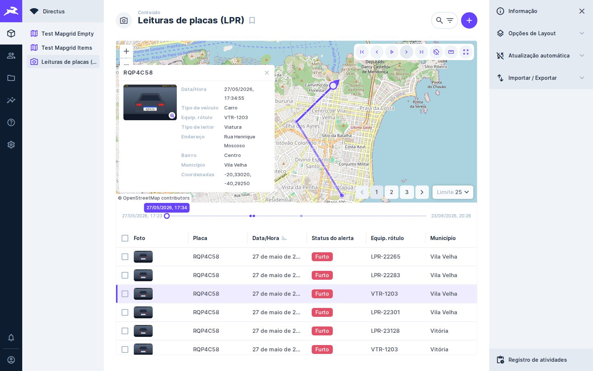
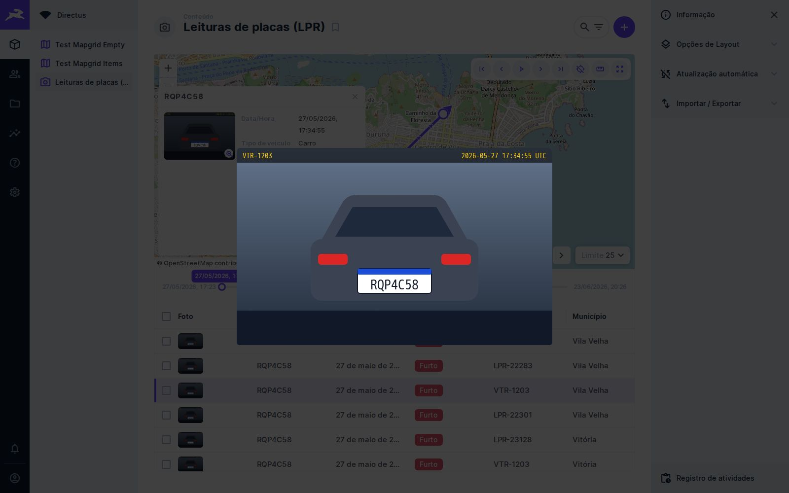
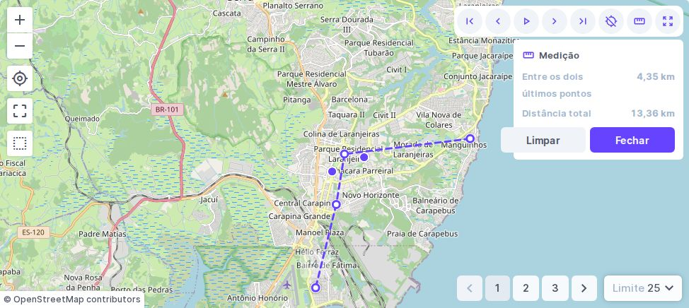

# 🧩 Task 025 — Os pedidos do GeoHub sobre a colecao LPR

- Status: done
- Type: feat
- Assignee: sidartaveloso
- Priority: 890

## Description
O documento "Pontos de melhoria para o módulo de tracking no GeoHub"
(`geohub/TASKS/assets/pontos-de-melhoria-tracking-geohub.pdf`) pede, para o
painel em lista e o painel em mapa, recursos que o MapGrid em parte já atende
quando configurado numa coleção de leitura de placas (LPR).

Esta task cria essa coleção no e2e, prova com teste cada pedido atendido e
fecha os que faltavam e cabiam aqui: foto da captura com ampliação, card da
captura ao clicar no ponto, ferramenta de medição e edição em lote. As tasks
018 a 022 (sentido, rastro, relógio dos dados e linha do tempo) foram
implementadas junto.

## Tasks
<!-- [x] feito · [ ] em aberto · [ ] ... — adiado: <razão> para o que se decidiu não fazer -->
- [x] `tests/helpers/lpr-collection.ts` — 51 leituras na Grande Vitória, de
      câmeras fixas, viaturas (`VTR-1203`) e ônibus (`BUS-0512`): a leitura
      móvel não depende de ponto fixo
- [x] Foto por leitura (`tests/helpers/lpr-photo.ts`), SVG gerado com a placa,
      o leitor e o instante — nada binário no repositório, e a placa legível
      quando ampliada
- [x] Campo `course` com valores negativos, como os rastreadores mandam
- [x] `pnpm test:collection` semeia a coleção LPR junto com as outras
- [x] Card da captura (`src/components/molecules/capture-card/`) com foto que
      amplia ao clicar e fecha com Esc; opções `showCard`, `cardImageField`,
      `cardFields`; linhas formatadas por `src/services/record-card/`
- [x] Medição (`src/services/distance-measure/` e
      `src/components/molecules/measure-overlay/`): botão na barra, clique marca
      ponto, perto de um registro o ponto vai até ele, último trecho e total
- [x] Edição em lote: é a do próprio Directus, que já aparece no cabeçalho com
      seleção — só faltava o teste que prova
- [x] e2e `tests/e2e/mapgrid-lpr.spec.ts`: colunas, foto na grade, filtros,
      ordenação, edição em lote, navegação, reprodução, clique no ponto, card
      com foto ampliada e medição
- [x] Rótulos em português na coleção LPR (campos, coleção e escolhas, estas por
      `directus_translations`), e o admin em pt-BR no `test:collection` e nas
      evidências
- [x] Evidência de tela, antes e depois, em português (`EVIDENCE_TASK=025`):
      `grade-com-foto`, `card-da-captura`, `foto-ampliada`, `medicao`,
      `edicao-em-lote` em `TASKS/assets/task-025-*`
- [ ] ... — adiado: exportação em PDF/XLSX, link temporário, painel resumo,
      mapa de calor, filtro por polígono/raio, camada de trânsito — fora do que
      o MapGrid cobre hoje

## Notes

### O que o documento pede e o MapGrid atende
| Pedido | Como |
| --- | --- |
| Filtros por status, endereço, município, bairro | Filtro do Directus, que vale para grade e mapa |
| Pré-visualização ampliada da imagem | Foto na grade e no card; clique amplia |
| Seleção múltipla e ações em lote | Seleção do Directus; editar e excluir no cabeçalho |
| Ordenação e colunas, layouts salvos | Cabeçalho da grade, preset e favoritos |
| Anterior / Próximo, centralização | Barra do MapGrid e teclado |
| Reprodução com velocidade | Intervalo fixo ou relógio dos dados (1× a 600×) |
| Linha do tempo | Entre o mapa e a grade, arrastável |
| Linhas e setas do sentido | Rastro com setas e seta no registro atual |
| Pré-visualização ao clicar no ponto | Card da captura com foto |
| Medição da distância | Ferramenta de medição |

### O clique durante a medição
A medição escuta o clique na fase de captura do painel do mapa e o interrompe:
enquanto ela está ligada, o mapa do Directus nunca vê o clique, e nenhum
registro é escolhido por acidente.

### Evidência
O "antes" é o mesmo spec rodado contra o `dist/index.js` construído a partir
de `d509074`, o commit anterior às tasks 018 a 025: lá os controles novos não
existem, e cada interação que precisa de um deles é pulada.

