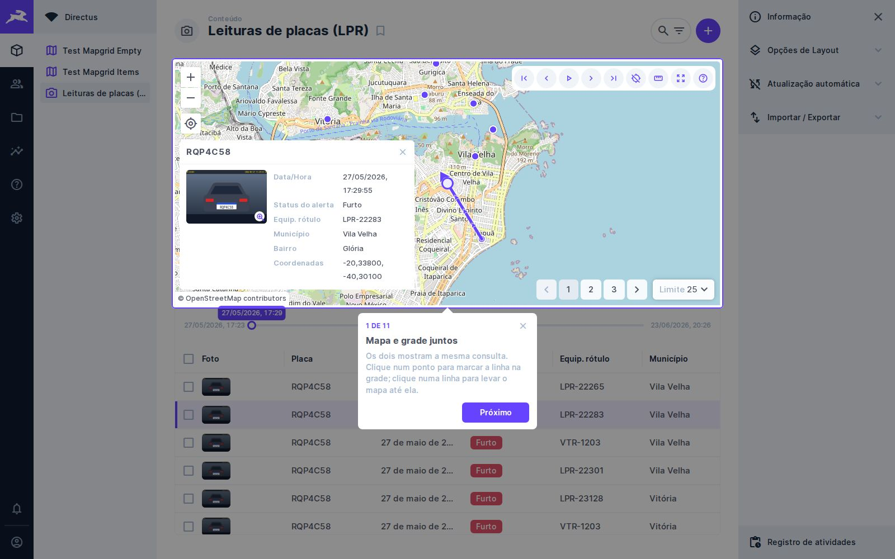
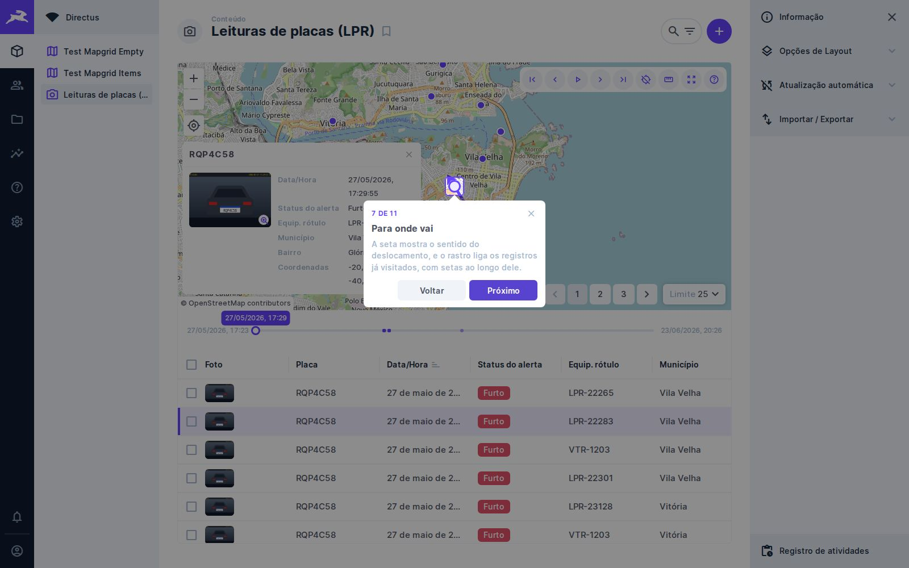

# 🧩 Task 026 — Apresentacao guiada e demonstracao somente leitura

- Status: done
- Type: feat
- Assignee: sidartaveloso
- Priority: 900

## Description
Pedido do Sidarta: um componente de apresentação que mostre, em balões, cada
recurso do MapGrid, para publicar um ambiente de demonstração somente leitura.

## Tasks
<!-- [x] feito · [ ] em aberto · [ ] ... — adiado: <razão> para o que se decidiu não fazer -->
- [x] `src/services/onboarding-tour/` — a sequência de 11 passos; passo cujo
      elemento não está na tela é pulado, e a contagem acompanha
- [x] `src/services/balloon-placement/` — o lado com espaço (baixo, cima,
      direita, esquerda), preso à tela, com a seta apontando para o meio do
      elemento
- [x] `src/services/tour-memory/` — lembra, por navegador, que a apresentação
      já foi vista; sem `localStorage` (janela privada) só deixa de lembrar
- [x] `src/components/molecules/tour-balloon/` — balão com contagem, Voltar,
      Próximo/Concluir e fechar, e o destaque que escurece o resto da tela
- [x] Botão **?** na barra; ←, → e Esc enquanto aberta; opção
      `tourOnFirstVisit` no preset e no painel
- [x] A apresentação põe o segundo registro em foco e espera o card, para a
      seta, o rastro e o card estarem na tela — e a contagem do primeiro balão
      ser a do fim
- [x] Textos en-US/pt-BR em `src/shared/messages.ts`
- [x] `docker-compose.demo.yml` e `pnpm demo` (`scripts/demo.ts`,
      `scripts/demo.seed.spec.ts`, `scripts/demo/`): coleção LPR em português,
      todos os recursos ligados, papel que só lê, visitante pt-BR, credenciais na
      tela de entrada, acesso anônimo fechado
- [x] A semente prova o somente leitura: como visitante, ler funciona e escrever
      dá 403; anônimo dá 403
- [x] e2e `tests/e2e/mapgrid-tour.spec.ts` e evidência (`EVIDENCE_TASK=026`)
- [x] README: apresentação guiada, controles da barra e a seção da demonstração

## Notes

### Por que sem biblioteca
`driver.js` e afins resolvem o balão, mas trazem o próprio CSS e não leem o
tema do Directus. O balão daqui usa as variáveis do tema, e a lógica que
importa — o que pular, onde pôr — ficou em duas classes puras e testadas.

### O que o Directus 10.13 ensinou
- `/permissions?fields=id` devolve `{}`; com `fields=id,action` o id vem;
- a lista de permissões do público traz as embutidas, sem id;
- e-mail com domínio `.demo` é recusado no login;
- o healthcheck do Postgres precisa ser por TCP: durante a inicialização um
  servidor temporário responde só no socket;
- um `:?` no compose impede até o `down`.

### O visitante pode trocar a própria senha
O Directus dá a todo usuário com acesso ao app a edição do próprio perfil.
Como os visitantes dividem o login, `pnpm demo seed` repõe a senha, o papel e o
layout a cada execução — o README recomenda agendá-lo.

### Evidência

