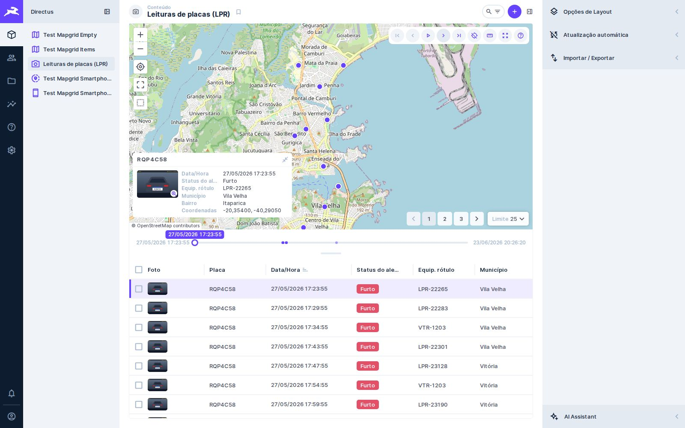

# 🧩 Task 029 — Câmera sem bbox numa geometria nativa

- Status: in-progress
- Type: fix
- Assignee: sidartaveloso
- Priority: 950

## Description
Com campo de geometria nativo (`geometry.Point`, como no geohub), o layout de
mapa do Directus 11 filtra pela área visível lendo `cameraOptions.bbox`. Um
preset escrito à mão, só com `center` e `zoom`, quebra esse código e deixa o
app inteiro em branco ("Cannot read properties of undefined (reading '0')").
Achado ao trocar a coleção LPR de `json` para `geometry.Point`; o preset do
geohub, copiado do `ensureLprMapGrid`, tem o mesmo problema.

## Tasks
<!-- [x] feito · [ ] em aberto · [ ] ... — adiado: <razão> para o que se decidiu não fazer -->
- [x] `src/services/camera-bounds/`: completa a câmera com um bbox folgado
      (4096 px, tiles de 512 do MapLibre) em volta do centro
- [x] `mapOptions` entrega a câmera completada ao mapa
- [x] Coleção LPR de teste em `geometry.Point`; pilha com a coluna em `json` é
      recriada
- [ ] Rodar os e2e com a geometria nativa — liga com a task-023 (o bbox zera a
      página compartilhada?) e com trilha e reprodução, que podem perder pontos
      fora da tela
- [x] Publicar a 2.0.1
- [ ] Sem câmera salva, uma coleção de geometria nativa abre no mapa-múndi: o
      Directus só enquadra os dados sozinho quando a geometria é `json`. Visto na
      coleção de smartphones (task-030); o geohub abre igual

### Evidência
`EVIDENCE_TASK=029`, `tests/screenshot/evidence-related.spec.ts`, no Directus
11.17.4: as leituras em `geometry.Point` com um preset cuja câmera só tem
centro e zoom. O "antes" é o mesmo spec contra o build da `v2.0.0`.

| Antes (2.0.0) | Depois (2.0.1) |
|---|---|
|  |  |
