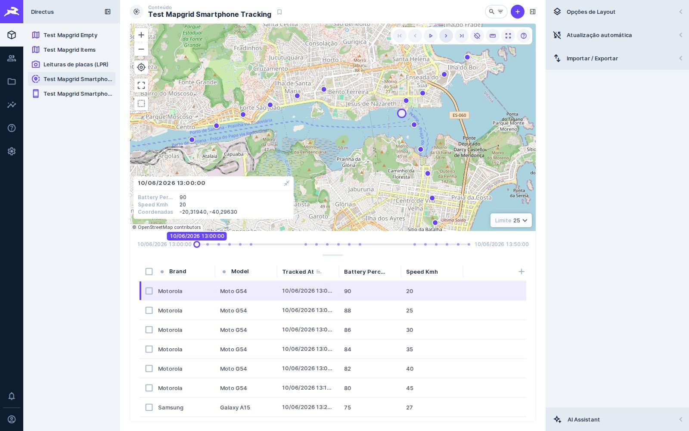
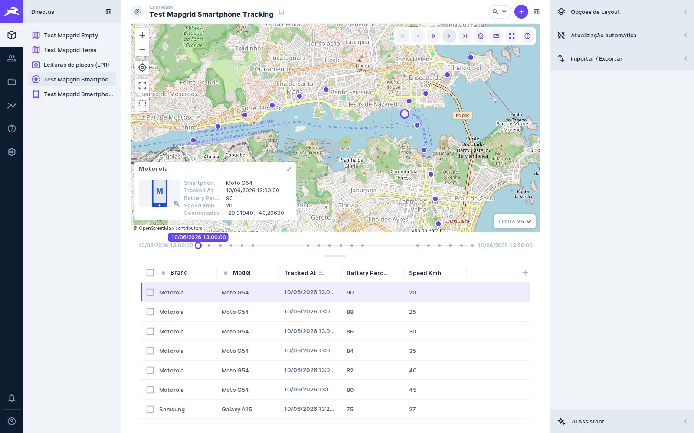
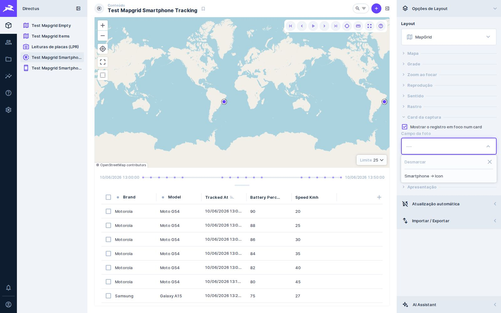

# 🧩 Task 030 — Campos de coleções relacionadas em todos os seletores

- Status: in-progress
- Type: feat
- Assignee: sidartaveloso
- Priority: 940

## Description
Pedido do Sidarta: todo seletor de campo das opções do MapGrid (imagem do card,
campos do card, data, rumo, rótulo etc.) oferece também campos alcançáveis por
relação muitos-para-um, não só os da própria coleção — por exemplo, a foto do
card vinda de `smartphone.icon`.

Hoje o seletor da imagem só lista arquivos da própria coleção, e o card lê o
valor direto no registro (`item[campo]`), sem seguir o caminho com ponto.

Para provar, coleções de teste no molde do geohub, com campos em inglês:
`test_mapgrid_smartphones` (`brand`, `model`, `icon`) e
`test_mapgrid_smartphone_tracking` (`smartphone` → smartphones, `location`
`geometry.Point`, `tracked_at`, `battery_percent`, `speed_kmh`, `accuracy_m`).

## Tasks
<!-- [x] feito · [ ] em aberto · [ ] ... — adiado: <razão> para o que se decidiu não fazer -->
- [x] Coleções de teste de smartphone (`tests/helpers/smartphone-collection.ts`),
      com ícones em SVG e um percurso por aparelho, em `geometry.Point`
- [x] `src/services/field-catalog/`: os campos da coleção e, uma relação
      muitos-para-um adiante, os da relacionada, por caminho e com o rótulo
      `Smartphone → Icon`; vem dos stores de campos e relações do app
- [x] `src/services/field-path/`: valor num caminho com ponto e filtro aninhado
- [x] Os quatro seletores (data da reprodução, rumo, imagem e campos do card)
      usam o catálogo
- [x] Card, imagem, data e rumo leem pelo caminho; o início e o fim da linha do
      tempo, por um campo relacionado, vêm de consultas ordenadas (o Directus
      não agrega através de relação) e os filtros vão aninhados
- [x] e2e `tests/e2e/mapgrid-related-fields.spec.ts` no Directus 11: grade com a
      marca e o modelo, card com o ícone, seletor com `Smartphone → Icon`
- [x] e2e: o botão de edição do cabeçalho segue funcionando com um e com
      vários registros selecionados (smartphones e LPR)
- [ ] A coleção entra na demonstração

### Decisão do Sidarta (pela sessão do geohub, 2026-10-21)
Toda opção que aponta para um campo aceita campo de coleção relacionada, em
qualquer profundidade, com os componentes do próprio Directus:
- texto (campos do card, título): o modelo de exibição
  (`system-display-template`), renderizado pelo motor de template do Directus;
  o valor antigo, nome de campo solto, segue aceito como `{{campo}}`
- campo único (imagem, data, rumo, geometria): o seletor em árvore
  (`system-field-tree`); ele não filtra por tipo, então a escolha é validada
  (imagem termina num `uuid` com `special: file`)
- relação de vários itens no meio do caminho: imagem usa o primeiro item

Tasks da decisão:
- [x] Campo único (data, rumo, imagem): árvore filtrada por tipo
      (`src/services/field-tree/`, `FieldPathSelect` + `FieldTreeLevel`) — só os
      campos do tipo e as relações que levam a um, até 3 níveis; na relação o
      clique abre, só o campo final é escolhido; arquivo é escolhido sem abrir
      `directus_files`. Ajustado com o Sidarta: em vez do `system-field-tree`,
      que não filtra por tipo nem separa abrir de escolher. e2e passa.
- [x] Linhas do card (`cardRows`): rótulo opcional + modelo de exibição
      (`v-collection-field-template`); linha de um campo só mantém a formatação
      do MapGrid, linha composta vai ao `render-template` do Directus; `cardFields`
      antigo é lido como uma linha `{{campo}}` cada (`src/services/card-rows/`,
      `CardRowsEditor`)
- [x] Lista de registros no meio do caminho: a imagem usa o primeiro, o texto
      junta com vírgula (`FieldPath.valueAt`/`firstAt`)
- [ ] e2e: linha composta no card e foto por `smartphone.photos.photo` — escritos,
      não rodaram (a máquina sobrecarregada não subiu o Directus)
- [ ] Mover a árvore para o pacote `@devix-tecnologia/directus-field-tree` no
      devix-stack (decisão do Sidarta), e o mapgrid importar de lá
- [ ] Geometria por caminho relacionado

### Evidência
`EVIDENCE_TASK=030`, `tests/screenshot/evidence-related.spec.ts`, no Directus
11.17.4. O "antes" é o mesmo spec contra o build do `develop` em `f8ea0b5`.

| Antes | Depois |
|---|---|
|  |  |
|  |  |
